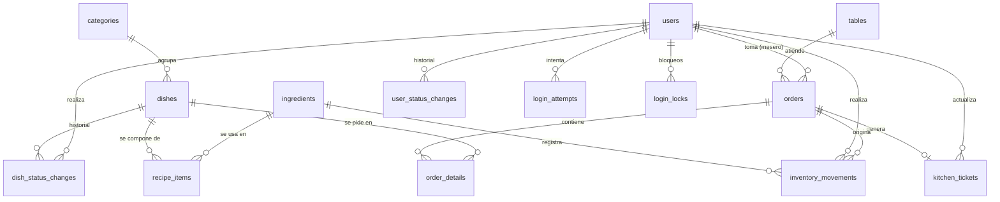

# Gran Parrillada Timbó — Backend (API REST)

API REST del sistema de gestión de pedidos, cocina e inventario de **Gran Parrillada Timbó**, restaurante de parrillas de 30 mesas. Proyecto del curso *Proyecto Tecnológico* (ISIL, NRC 3710), desarrollado con Scrum.

Hoy el restaurante registra los pedidos en un sistema digital y las áreas reciben tickets, pero las modificaciones pueden comunicarse de forma verbal, el estado de las comandas no se sigue y los ingredientes no se descuentan a partir de los pedidos (el inventario se lleva en un kardex). Este sistema busca centralizar los pedidos con sus observaciones, dar seguimiento a las comandas y descontar los ingredientes según la receta de cada plato.

- Frontend: https://github.com/Isai-Arellano-Koo/system_gran_parrillada_timbo_frontend
- Tablero Scrum (Trello): https://trello.com/b/8duBXs5H/project-gran-parrillada-timbo
- Diseños (Figma): https://www.figma.com/design/HFS3KQvvDFlRI30mvj2E5v/Gran-Parrillada-Timbo?node-id=2-2
- API desplegada (Railway): https://systemgranparrilladatimbobackend-production.up.railway.app/

## Alcance por sprint

| Sprint | Historias | Funcionalidad |
|---|---|---|
| Sprint 1 | HU16, HU01, HU02, HU03 | Registro de usuarios por rol, inicio de sesión, ingredientes, stock inicial y entradas |
| Sprint 2 | Historias del Sprint Backlog entre HU04 y HU15, y mejoras aprobadas | Carta (platos, categorías y recetas), flujo completo del pedido (apertura, validación de stock, confirmación, comanda y descuento de inventario), cancelaciones, movimientos y alertas de stock; control de intentos fallidos de login, motivo de cambio de estado de usuarios e ingredientes sin modificar stock |

Qué historias entraron en cada sprint y su estado de validación se registran en el tablero de Trello. A continuación, dónde vive cada historia en el código.

## Historias y dónde están en el código

| HU | Historia | Dónde |
|---|---|---|
| HU16 | Registrar usuario según rol | `POST /api/users`, `POST /api/auth/register` |
| HU01 | Iniciar sesión según rol | `POST /api/auth/login` |
| HU02 | Registrar ingredientes | `/api/catalog/ingredients` |
| HU03 | Registrar stock inicial y entradas | `POST /api/inventory/entries` |
| HU04 | Registrar platos | `/api/catalog/dishes` y `/api/catalog/categories` |
| HU05 | Asociar recetas a los platos | `PUT /api/catalog/dishes/:dishId/recipe` |
| HU06 | Abrir un pedido para una mesa | `POST /api/orders` |
| HU07 | Agregar platos y observaciones | `POST` y `PATCH /api/orders/:orderId/details` |
| HU08 | Validar disponibilidad de ingredientes | `POST /api/orders/:orderId/validate-stock` |
| HU09 | Confirmar el pedido y calcular el total | `POST /api/orders/:orderId/confirm` |
| HU10 | Generar y enviar la comanda a cocina | Se genera al confirmar; `GET /api/kitchen` |
| HU11 | Visualizar y cambiar el estado de la comanda | `PATCH /api/kitchen/:ticketId/status` y `PATCH /api/kitchen/details/:detailId/status` |
| HU12 | Descontar ingredientes automáticamente | Dentro de la confirmación del pedido |
| HU13 | Cancelar pedidos y gestionar stock o merma | `POST /api/orders/:orderId/cancel` |
| HU14 | Consultar movimientos de inventario | `GET /api/inventory/movements` |
| HU15 | Alertar por stock mínimo | `GET /api/inventory/alerts` |
| HU17 | Registrar ajustes de inventario | `POST /api/inventory/adjustments` |

### Reglas de negocio que implementa el flujo del pedido

- Una mesa no puede tener dos pedidos abiertos a la vez, ni abrirse un pedido en una mesa que sigue ocupada.
- El pedido debe tener al menos un plato, y la cantidad de cada plato debe ser un entero mayor que cero.
- Al confirmar, la confirmación, la comanda y el descuento de inventario se guardan **juntos o no se guarda nada**, y el stock nunca puede quedar negativo.
- Un plato ya enviado a cocina no se puede modificar ni eliminar. Si el cliente pide más, se envían como **platos adicionales** (extras).
- Al cancelar, el motivo es obligatorio: si cocina todavía no empezó, el stock vuelve; si ya se cocinó, se registra como merma.
- Se registra si el pedido fue pagado. Al cerrar el pedido, la mesa se libera.
- Los movimientos de inventario no se pueden borrar; las correcciones se hacen con un ajuste.
- El código del pedido combina la mesa, el día y mes, y un correlativo del día (por ejemplo `M01-2610-03`).

## Tecnologías

| Componente | Tecnología |
|---|---|
| Entorno | Node.js + TypeScript |
| Framework | Express 5 |
| Base de datos | PostgreSQL con Sequelize (ORM) |
| Autenticación | JWT (`jsonwebtoken`) |
| Contraseñas | Hash con `bcrypt` (12 rondas de sal) |
| Correo de verificación | API HTTPS de Brevo |
| Registro de peticiones | morgan |
| Pruebas | Vitest |
| Desarrollo | tsx + nodemon |
| Despliegue | Railway |

## Requisitos previos

- Node.js 20.19 o superior (se recomienda la versión LTS)
- PostgreSQL local, o la base de datos de Railway
- Cuenta de Brevo con remitente verificado (solo para el envío del código por correo)

## Instalación y ejecución local

```bash
# 1. Clonar e instalar
git clone https://github.com/Isai-Arellano-Koo/system_gran_parrillada_timbo_backend.git
cd system_gran_parrillada_timbo_backend
npm install

# 2. Variables de entorno
cp .env.example .env
# editar .env (ver tabla más abajo)

# 3. Crear la base de datos vacía en PostgreSQL
#    (nombre por defecto: gran_parrillada_timbo)

# 4. Crear/actualizar las tablas
npm run db:sync

# 5. Cargar datos iniciales (usuarios de prueba, 30 mesas, categorías y la carta del restaurante)
npm run db:seed

# Vaciar la base y volver a cargar la semilla (incluye la carta de setiembre 2026).
# Solo para tu entorno local: borra los datos.
npm run db:reset

# 6. Levantar el servidor
npm run dev
```

El servidor queda en `http://localhost:3000`. Para comprobar que funciona: `GET /api/health`.

## Variables de entorno

| Variable | Descripción | Valor por defecto |
|---|---|---|
| `PORT` | Puerto del servidor | `3000` |
| `NODE_ENV` | Entorno | `development` |
| `DATABASE_URL` | Cadena de conexión completa. Si está definida, tiene prioridad sobre `DB_*` | vacío |
| `DB_HOST`, `DB_PORT`, `DB_NAME`, `DB_USER`, `DB_PASSWORD` | Conexión por partes | `localhost`, `5432`, `gran_parrillada_timbo`, `postgres`, `postgres` |
| `DB_DIALECT` | Dialecto | `postgres` |
| `DB_SSL` | `true` para el proxy público de Railway (`*.proxy.rlwy.net`) | `false` |
| `DB_SYNC` | `true` solo en desarrollo para crear/alterar tablas automáticamente | `false` |
| `DB_LOGGING` | Muestra las consultas SQL | `false` |
| `JWT_SECRET` | Clave para firmar los tokens. **Debe cambiarse siempre** | — |
| `JWT_EXPIRES_IN` | Duración del token | `8h` |
| `CORS_ORIGIN` | Origen permitido (URL del frontend) | `http://localhost:5173` |
| `BREVO_API_KEY` | Clave de la API de Brevo | vacío |
| `BREVO_SENDER` | Remitente verificado en Brevo | vacío |

El archivo `.env` está en `.gitignore` y nunca debe subirse al repositorio.

## Scripts

| Comando | Descripción |
|---|---|
| `npm run dev` | Servidor en desarrollo con recarga automática |
| `npm run build` | Compila TypeScript a `dist/` |
| `npm start` | Ejecuta la versión compilada (producción) |
| `npm run db:sync` | Sincroniza los modelos con la base de datos |
| `npm run db:seed` | Crea usuarios de prueba, 30 mesas, categorías y la carta (platos, ingredientes y recetas) |
| `npm run db:reset` | Vacía la base de datos y vuelve a cargar la semilla. **Borra datos: no usar en Railway con información real** |
| `npm test` | Ejecuta las pruebas con Vitest |

## Usuarios de prueba (solo desarrollo)

El comando `npm run db:seed` carga además la **carta de Gran Parrillada Timbó** (19 categorías, sus platos con precio, los ingredientes y las recetas), de modo que el sistema se pruebe con datos parecidos a los reales. Los ingredientes de la carta quedan con stock en 0 y un stock mínimo según su unidad (para ver descuentos y alertas, primero hay que registrar entradas de stock). Crea tres usuarios: `admin`, `mesero` y `cocinero`. Sus correos y contraseñas iniciales están en `src/scripts/seed.ts`. **No usar estas credenciales en un entorno real**: cámbialas o elimina los usuarios antes de usar el sistema con datos del restaurante.

## Roles

| Rol | Permisos principales |
|---|---|
| `admin` | Control total: usuarios, catálogo, inventario, pedidos y cocina |
| `mesero` | Abre y gestiona pedidos; consulta comandas |
| `cocinero` | Consulta y actualiza el estado de las comandas |
| `cajero` | Rol disponible para consulta del resumen del local |

## Endpoints

Todas las rutas empiezan con `/api`. Salvo las públicas, requieren el encabezado `Authorization: Bearer <token>`.

**Salud y autenticación (HU01, HU16)**

| Método | Ruta | Descripción | Acceso |
|---|---|---|---|
| GET | `/api/health` | Estado del servicio | Público |
| POST | `/api/auth/login` | Inicio de sesión con correo o nombre de usuario | Público |
| POST | `/api/auth/confirm-email` | Confirma el correo con el código recibido | Público |
| POST | `/api/auth/confirm-email/resend` | Reenvía el código | Público |
| POST | `/api/auth/password-reset` | Solicita el restablecimiento de contraseña | Público |
| POST | `/api/auth/password-reset/confirm` | Confirma el nuevo password con el código | Público |
| POST | `/api/auth/register` | Registra un usuario con rol | admin |
| GET | `/api/auth/me` | Datos de la sesión actual | Autenticado |
| POST | `/api/auth/logout` | Cierra sesión | Autenticado |

**Usuarios (HU16)** — solo `admin`

| Método | Ruta | Descripción |
|---|---|---|
| GET | `/api/users` | Lista usuarios |
| POST | `/api/users` | Crea usuario |
| GET | `/api/users/:id` | Detalle de usuario |
| PATCH | `/api/users/:id` | Modifica rol o activa/desactiva (registra el motivo) |
| GET | `/api/users/status-changes` | Historial de cambios de estado de todos los usuarios |
| GET | `/api/users/:id/status-changes` | Historial de cambios de estado de un usuario |

**Catálogo (HU02, HU04, HU05)** — la lectura la hace cualquier usuario autenticado; crear o modificar es solo del `admin`

| Método | Ruta | Descripción | Acceso |
|---|---|---|---|
| GET | `/api/catalog/ingredients` | Lista ingredientes | Autenticado |
| POST | `/api/catalog/ingredients` | Crea ingrediente | admin |
| PATCH | `/api/catalog/ingredients/:id` | Modifica o activa/desactiva | admin |
| GET | `/api/catalog/categories` | Lista categorías | Autenticado |
| POST | `/api/catalog/categories` | Crea o reactiva una categoría | admin |
| PATCH | `/api/catalog/categories/:id` | Renombra o reactiva | admin |
| DELETE | `/api/catalog/categories/:id` | Quita la categoría e inhabilita sus platos | admin |
| GET | `/api/catalog/dishes` | Lista platos | Autenticado |
| GET | `/api/catalog/dishes/:id` | Detalle del plato con su receta | Autenticado |
| GET | `/api/catalog/dishes/:id/status-changes` | Historial de cambios de estado del plato | admin |
| POST | `/api/catalog/dishes` | Crea plato (requiere categoría activa) | admin |
| PATCH | `/api/catalog/dishes/:id` | Modifica o activa/desactiva | admin |
| PUT | `/api/catalog/dishes/:dishId/recipe` | Define la receta del plato | admin |

**Inventario (HU03, HU12 a HU15)** — solo `admin`

| Método | Ruta | Descripción |
|---|---|---|
| POST | `/api/inventory/entries` | Registra stock inicial o entrada |
| POST | `/api/inventory/adjustments` | Registra un ajuste |
| GET | `/api/inventory/movements` | Lista movimientos; filtros por `ingredient_id`, `type`, `user_id`, `from` y `to` |
| DELETE | `/api/inventory/movements/:id` | Siempre se rechaza: los movimientos no se borran |
| GET | `/api/inventory/alerts` | Ingredientes en stock mínimo |

**Pedidos (HU06 a HU09, HU12 y HU13)**

| Método | Ruta | Descripción | Acceso |
|---|---|---|---|
| GET | `/api/orders/tables` | Lista mesas | Autenticado |
| POST | `/api/orders/tables/seed` | Crea las mesas | admin |
| GET | `/api/orders` | Lista pedidos | mesero, admin, cocinero |
| GET | `/api/orders/:orderId` | Detalle del pedido | mesero, admin, cocinero |
| POST | `/api/orders` | Abre un pedido para una mesa | mesero, admin |
| POST | `/api/orders/:orderId/details` | Agrega plato, cantidad y observación | mesero, admin |
| PATCH | `/api/orders/:orderId/details/:detailId` | Modifica cantidad u observación de un plato | mesero, admin |
| DELETE | `/api/orders/:orderId/details/:detailId` | Elimina un detalle | mesero, admin |
| POST | `/api/orders/:orderId/validate-stock` | Valida disponibilidad de ingredientes | mesero, admin |
| POST | `/api/orders/:orderId/confirm` | Confirma el pedido, genera la comanda y descuenta los ingredientes en una sola operación | mesero, admin |
| POST | `/api/orders/:orderId/additions` | Envía a cocina los platos adicionales de una mesa con pedido abierto | mesero, admin |
| PATCH | `/api/orders/:orderId/paid` | Marca el pedido como pagado o sin pagar | mesero, admin, cajero |
| POST | `/api/orders/:orderId/close` | Cierra el pedido y libera la mesa | mesero, admin |
| POST | `/api/orders/:orderId/cancel` | Cancela el pedido con motivo (el stock vuelve o se registra merma) | admin, mesero |

**Cocina (HU10, HU11)**

| Método | Ruta | Descripción | Acceso |
|---|---|---|---|
| GET | `/api/kitchen` | Lista comandas | cocinero, admin, mesero |
| PATCH | `/api/kitchen/:ticketId/status` | Cambia el estado de la comanda | cocinero, admin |
| PATCH | `/api/kitchen/details/:detailId/status` | Cambia el estado de un plato dentro de la comanda | cocinero, admin, mesero |

## Estados y tipos definidos

| Concepto | Valores |
|---|---|
| Unidades de medida | `kg`, `g`, `lt`, `ml`, `unidad` |
| Estado del pedido | `en_edicion`, `confirmado`, `cerrado`, `cancelado` |
| Estado de la comanda y de cada plato | `pendiente`, `en_preparacion`, `listo`, `entregado` |
| Tipos de movimiento de inventario | `entrada`, `salida_venta`, `devolucion`, `ajuste`, `merma` |

## Modelo de datos

| Tabla | Propósito |
|---|---|
| `users` | Colaboradores: rol, estado activo, correo verificado, contraseña hasheada |
| `email_verifications` | Códigos de confirmación de correo (guardados como hash, con vencimiento y uso) |
| `ingredients` | Insumos: unidad, stock actual, stock mínimo, estado |
| `categories` | Categorías de la carta; al quitarlas se inhabilitan sus platos |
| `dishes` | Platos del menú: categoría, presentación, precio, descripción, estado |
| `dish_status_changes` | Historial de activaciones y desactivaciones de platos |
| `user_status_changes` | Historial de activaciones y desactivaciones de usuarios, con su motivo |
| `login_attempts` / `login_locks` | Intentos fallidos de inicio de sesión y bloqueos temporales |
| `recipe_items` | Ingredientes y cantidades de cada plato |
| `tables` | Las 30 mesas del salón |
| `orders` | Pedidos: código, mesa, mesero, estado, total, pagado (monto y fecha), motivo de cancelación |
| `order_details` | Platos de cada pedido: cantidad, precio unitario, observación y estado en cocina |
| `kitchen_tickets` | Comandas: estado y quién lo cambió |
| `inventory_movements` | Historial de movimientos: ingrediente, tipo, cantidad, motivo, pedido y usuario |



## Estructura del proyecto

```
src/
├── config/        # Entorno y conexión a la base de datos
├── routes/        # Definición de rutas por módulo
├── controllers/   # Controladores por módulo
├── handlers/      # Lógica de cada endpoint
├── middlewares/   # Autenticación, roles y manejo de errores
├── models/        # Modelos de Sequelize
├── helpers/       # Hash de contraseñas, tokens y correo
├── scripts/       # syncDb y seed
├── types/         # Enumeraciones y tipos
├── app.ts         # Configuración de Express
└── index.ts       # Arranque del servidor
test/              # Pruebas (api.test.ts, sprint2.test.ts, mail.test.ts)
```

## Seguridad

- Las contraseñas se guardan con hash `bcrypt`, nunca en texto plano.
- Autenticación con JWT y control de acceso por rol en cada ruta.
- La cuenta se activa al confirmar el correo con un código de 15 minutos, enviado por Brevo.
- Tras **5 intentos fallidos en 15 minutos**, la cuenta se bloquea 15 minutos.
- Cada cambio de estado de un usuario o de un plato queda registrado en un historial, con su motivo.
- Un administrador no puede cambiar su propio rol ni desactivarse.
- CORS limitado al origen configurado en `CORS_ORIGIN`.

## Pruebas

```bash
npm test
```

Incluye pruebas de API (casos CP01 a CP107): login con correo y usuario, bloqueo por intentos fallidos, registro y permisos por rol, validación de ingredientes y de stock, entradas, movimientos y alertas, confirmación de correo. Un archivo aparte, `sprint2.test.ts`, reúne las pruebas del Sprint 2 (69 casos: carta, recetas, flujo de pedidos, comandas, cancelaciones e inventario). También hay pruebas del envío de correo con Brevo.

Las pruebas de API **necesitan una base de datos separada**: defina `TEST_DATABASE_URL` en un archivo `.env.test` (no se sube al repositorio). Si apunta a la misma base que `DATABASE_URL`, las pruebas se detienen para proteger los datos reales.

## Despliegue en Railway

1. Crear el servicio desde el repositorio de GitHub y agregar una base de datos PostgreSQL.
2. Configurar las variables de entorno en el panel de Railway (`DATABASE_URL`, `JWT_SECRET`, `CORS_ORIGIN` con la URL del frontend, `BREVO_API_KEY`, `BREVO_SENDER`).
3. Usar `DB_SSL=true` si se conecta por el proxy público.
4. Comandos: build `npm run build`, inicio `npm start`.

## Por qué lo hicimos así

| Decisión | Motivo |
|---|---|
| Contraseñas con `bcrypt` (12 rondas) | Definimos la tecnología de hash en el tablero (incidencia de Trello) y elegimos una librería ampliamente usada; nunca guardamos contraseñas en texto plano. |
| Login con correo **o** nombre de usuario | Al principio solo entraba con correo. Lo corregimos porque el personal del restaurante usa su usuario en el día a día (pruebas CP01 y CP02). |
| Código de verificación por correo, guardado como hash y con vencimiento de 15 minutos | Queremos confirmar que el correo del colaborador existe sin dejar el código legible en la base de datos. |
| Envío de correo con la API HTTPS de Brevo en lugar de SMTP | El correo se envía por HTTPS (puerto 443), sin abrir conexiones SMTP desde el servidor. Se configura con `BREVO_API_KEY` y `BREVO_SENDER`. |
| Un administrador no puede cambiar su propio rol ni desactivarse | Evita que el sistema se quede sin administrador por un error (CP14 y CP15). |
| Pruebas con una base de datos separada | Las pruebas se detienen si apuntan a la base real, para no borrar datos del restaurante por accidente. |
| Stock con 3 decimales | Los insumos de una parrilla se manejan en kilos, gramos y litros, no solo en unidades enteras. |
| Bloqueo temporal tras 5 intentos fallidos | Mejora aprobada tras la Sprint Review del Sprint 1. Frena los intentos de adivinar contraseñas: 5 fallos en 15 minutos bloquean la cuenta durante 15 minutos. |
| Historial de cambios de estado con motivo | Mejora aprobada: cada activación o desactivación debe tener responsable y razón, para que se pueda rastrear. |
| Carga de la carta real del restaurante en el seed | Probamos con platos, precios y recetas parecidos a los del restaurante, no con datos de ejemplo. Los platos y precios siguen la carta del restaurante (`src/scripts/cartaTimboSet2026.ts`); las cantidades de las recetas (`cartaRecipes.ts`) sirven para probar el descuento de inventario. |
| Rol `cajero` incorporado al modelo | Surgió como incidencia en el tablero; hoy existe en el sistema y en las pruebas. |

## Dificultades que tuvimos

- **Inicio de sesión solo por correo:** lo detectamos al probar y lo resolvimos aceptando también el nombre de usuario.
- **Tecnología de hash sin definir:** quedó registrada como incidencia y se cerró al adoptar `bcrypt`.
- **Pedidos múltiples por mesa (HU06):** se validó con el Product Owner si el restaurante lo permite. En el sistema, una mesa no puede tener dos pedidos en edición a la vez: si ya tiene uno abierto, el backend lo rechaza con el mensaje "La mesa ya tiene un pedido en edición".
- **Disponibilidad del equipo:** varios integrantes trabajan durante el día, así que el avance fue irregular. Acordamos dailies martes, viernes y sábado a las 10 pm, con aviso previo y avance por escrito si alguien no puede asistir.

## Cómo demostrar el Sprint 1

1. Iniciar sesión como `admin`.
2. Registrar un usuario nuevo con rol mesero y revisar que pide confirmar el correo.
3. Cerrar sesión e ingresar con ese usuario por nombre de usuario y por correo.
4. Como admin, registrar un ingrediente de la parrilla, por ejemplo un corte de carne en `kg`.
5. Registrar el stock inicial y una entrada posterior.
6. Consultar los movimientos y comprobar que quedaron el tipo, la cantidad y el usuario.

## Cómo demostrar el Sprint 2

1. Como `admin`, revisar la carta cargada: categorías, platos y la receta de uno de ellos.
2. Registrar una entrada de stock para los ingredientes de ese plato .
3. Como `mesero`, abrir un pedido en una mesa, agregar el plato con una observación (por ejemplo el término de cocción) y validar el stock.
4. Confirmar el pedido. Comprobar que se creó la comanda y que el inventario se descontó.
5. Como `cocinero`, cambiar el estado de la comanda y de un plato.
6. Como `mesero`, enviar un plato adicional a la misma mesa, marcar el pago y cerrar el pedido.
7. Como `admin`, consultar los movimientos filtrando por ingrediente y revisar las alertas de stock mínimo.
8. Probar un caso de error: intentar confirmar un pedido sin stock suficiente, o cancelarlo sin motivo.

## Pendiente y limitaciones

- Las historias del Sprint 2 están implementadas y cubiertas por pruebas; su validación final contra los criterios de aceptación y la Definition of Done queda registrada en Trello.
- Las pruebas de API requieren una base de datos de prueba separada configurada en `.env.test`.
- El correo de verificación solo se envía si están configuradas las credenciales de Brevo; en una instalación local sin ellas, esa parte no funciona.

## Equipo

| Integrante | Rol Scrum | Aporte |
|---|---|---|
| Mateo Alejandro Goto Gusukuda | Product Owner | Gestión, priorización y validación del Product Backlog |
| Alessandro Del Piero Chavarria Medina | Scrum Master / Developer | Facilitación de Scrum, seguimiento del tablero y README |
| Isai Kaleb Arellano Koo | Developer | Desarrollo del backend y del frontend  |
| Paul Marcelo Challco Peña | Integrator / UX-UI | Informe técnico y documentación |
| Victor Samir Huallpa Alvites | Developer | Pruebas del Sprint 2  y apoyo en desarrollo a Isai y a Mateo |

## Uso de herramientas de IA

Las herramientas de IA empleadas y las partes del código donde se usaron se declaran en el **Anexo A** del informe técnico. Todo el código asistido fue revisado, probado y adaptado por el equipo.